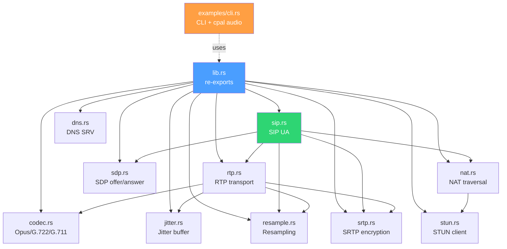
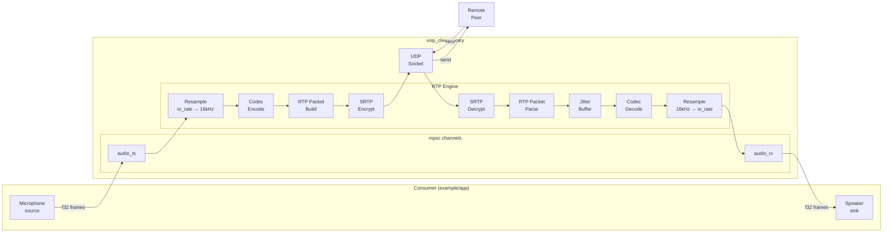
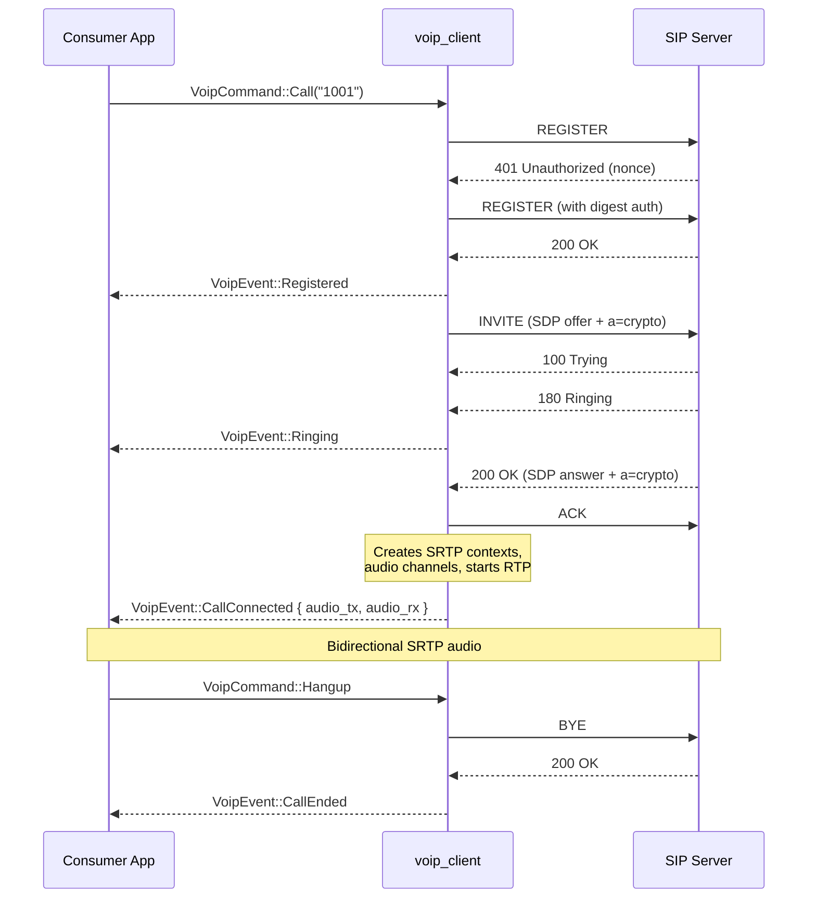
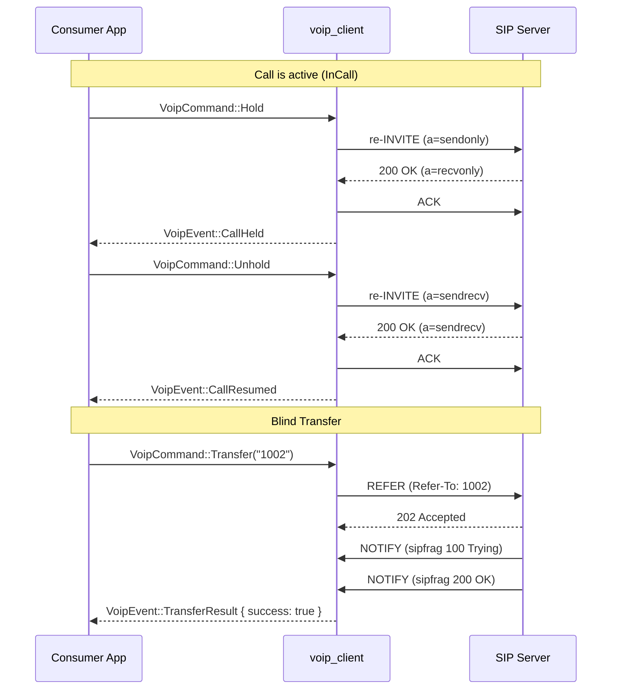

# voip_client

A pure-Rust SIP/RTP VoIP library with **no audio hardware dependency**.

The library handles SIP signaling, RTP media transport, codec encoding/decoding
(Opus, G.722, G.711), SRTP encryption with automatic SDES key exchange, DTMF,
NAT traversal (STUN + UPnP), DNS SRV discovery, call transfer (REFER), and
hold/unhold. Audio I/O is left to the consumer via `mpsc` channels, making the
library usable on any platform (desktop, Android, embedded) and in any audio pipeline.

---

## Stack Summary

| Layer        | Technology                        |
|--------------|-----------------------------------|
| Language     | Rust 2021 edition                 |
| Async runtime| Tokio (full features)             |
| SIP transport| Raw UDP sockets + TLS via tokio-rustls |
| RTP transport| Tokio UDP sockets                 |
| Audio codecs | Opus (audiopus/libopus), G.722 (pure Rust), G.711 (pure Rust) |
| Encryption   | SRTP AES-128-CM + HMAC-SHA1-80 with SDES key exchange (pure Rust) |
| NAT traversal| STUN (pure Rust) + UPnP-IGD (igd-next) |
| DNS          | hickory-resolver (SRV + A/AAAA)   |
| TLS          | rustls + webpki-roots             |

---

## Libraries Used

| Crate              | Version  | Purpose                                           |
|--------------------|----------|---------------------------------------------------|
| `tokio`            | 1        | Async runtime, UDP/TCP sockets, channels, timers  |
| `anyhow`           | 1        | Error handling with context                       |
| `tracing`          | 0.1      | Structured logging                                |
| `tracing-subscriber`| 0.3     | Log output formatting with env-filter             |
| `rand`             | 0.8      | Random generation (Call-ID, tags, SSRC, ports)    |
| `md-5`             | 0.10     | MD5 digest for SIP authentication (RFC 2617)      |
| `hex`              | 0.4      | Hex encoding for digest auth response             |
| `tokio-rustls`     | 0.26     | Async TLS transport for SIP over TLS              |
| `rustls`           | 0.23     | TLS implementation (no OpenSSL dependency)         |
| `webpki-roots`     | 0.26     | Mozilla CA root certificates for TLS verification |
| `rustls-pki-types` | 1        | PKI type definitions for rustls                   |
| `audiopus`         | 0.3.0-rc| Safe Rust bindings to libopus codec               |
| `aes`              | 0.8      | AES block cipher for SRTP encryption              |
| `ctr`              | 0.9      | CTR mode for SRTP AES-128-CM                      |
| `hmac`             | 0.12     | HMAC for SRTP authentication tags                 |
| `sha1`             | 0.10     | SHA-1 for SRTP HMAC-SHA1-80                       |
| `base64`           | 0.22     | Base64 for SRTP crypto attribute in SDP           |
| `igd-next`         | 0.15     | UPnP-IGD port mapping for NAT traversal           |
| `hickory-resolver` | 0.25     | DNS SRV/A/AAAA resolution for SIP discovery       |
| `cpal` *(dev-only)*| 0.15     | Cross-platform audio I/O (example only)           |

---

## API Summary by Module

### `sip.rs` — SIP User Agent

The core state machine. Handles registration, call setup/teardown, authentication,
session timers, PRACK, REFER, hold/unhold, and SRTP key management.

```rust
pub enum Transport { Udp, Tls }

pub struct VoipConfig {
    pub server_addr: SocketAddr,
    pub username: String,
    pub password: String,
    pub realm: String,
    pub transport: Transport,
    pub hostname: String,
    pub stun_server: Option<String>,
    pub io_sample_rate: u32,  // default 16000; set 48000 for 48 kHz pipeline
    pub io_frame_ms: u32,     // default 20; set 10 for 10 ms frames
}

pub enum VoipCommand {
    Call(String),                              // Dial a SIP URI
    Answer,                                    // Answer incoming call
    Hangup,                                    // End current call
    SendDtmf(char),                            // Send DTMF digit
    Hold,                                      // Put call on hold
    Unhold,                                    // Resume held call
    Transfer(String),                          // Blind transfer (REFER)
    AttendedTransfer { target_call_id: String },// Attended transfer
    Quit,                                      // Unregister and shut down
}

pub enum VoipEvent {
    Registered,
    RegistrationFailed(String),
    IncomingCall { from: String },
    Ringing,
    CallConnected { audio_tx: Sender<Vec<f32>>, audio_rx: Receiver<Vec<f32>> },
    CallEnded,
    CallFailed { reason: String },
    DtmfReceived(char),
    CallHeld,
    CallResumed,
    TransferResult { success: bool, reason: String },
}

pub struct SipClient { /* ... */ }
impl SipClient {
    pub async fn new(config: VoipConfig) -> Result<Self>;
    pub async fn run(&mut self, cmd_rx: Receiver<VoipCommand>, event_tx: Sender<VoipEvent>) -> Result<()>;
}
```

**Protocols implemented:** REGISTER, INVITE, ACK, BYE, CANCEL, PRACK (RFC 3262),
REFER (RFC 3515), NOTIFY (sipfrag), re-INVITE (hold/session-timer), digest auth
(RFC 2617 with qop=auth), session timers (RFC 4028), SRTP via SDES (RFC 4568).

### `rtp.rs` — RTP Media Transport

Sends and receives RTP packets over UDP. Bridges audio channels to the codec layer.

```rust
pub async fn start_session(
    remote_addr: SocketAddr,
    codec: Codec,
    mic_rx: Receiver<Vec<f32>>,
    spk_tx: Sender<Vec<f32>>,
    dtmf_rx: Receiver<char>,
    event_tx: Option<Sender<VoipEvent>>,
    srtp_send: Option<SrtpContext>,
    srtp_recv: Option<SrtpContext>,
) -> Result<(u16, oneshot::Sender<()>)>;
```

- Send path: `mic_rx` → encode → RTP packet → SRTP encrypt → UDP send
- Receive path: UDP recv → SRTP decrypt → jitter buffer → decode → `spk_tx`
- SRTP encryption/decryption is automatic when crypto keys are exchanged via SDP
- DTMF send (RFC 4733 telephone-event) and receive with event detection
- Automatic 16 kHz ↔ 8 kHz resampling for G.711 codecs

### `codec.rs` — Audio Codecs

```rust
pub enum Codec { Opus, G722, Ulaw, Alaw }
impl Codec {
    pub fn payload_type(&self) -> u8;
    pub fn clock_rate(&self) -> u32;
    pub fn frame_size(&self) -> usize;      // samples per codec frame
}

pub struct CodecState { /* ... */ }
impl CodecState {
    pub fn new(codec: Codec) -> Self;
    pub fn encode_frame(&mut self, pcm: &[f32]) -> Result<Vec<u8>>;
    pub fn decode_frame(&mut self, data: &[u8]) -> Result<Vec<f32>>;
}
```

| Codec | PT  | Clock  | Audio  | Implementation    |
|-------|-----|--------|--------|-------------------|
| Opus  | 111 | 48 kHz | 16 kHz | libopus via audiopus |
| G.722 | 9   | 8 kHz* | 16 kHz | Pure Rust (Sub-Band ADPCM) |
| PCMU  | 0   | 8 kHz  | 8 kHz  | Pure Rust (μ-law) |
| PCMA  | 8   | 8 kHz  | 8 kHz  | Pure Rust (A-law) |

*G.722 uses 8 kHz in RTP per RFC 3551 despite being a 16 kHz wideband codec.

### `sdp.rs` — SDP Offer/Answer

```rust
pub struct SdpOffer {
    pub codecs: Vec<(u8, Codec)>,
    pub ip: IpAddr,
    pub port: u16,
    pub ptime: u16,
    pub crypto: Option<String>,          // remote a=crypto line
    pub telephone_event_pt: Option<u8>,
}
pub fn build_offer(local_ip: IpAddr, rtp_port: u16, crypto_attr: Option<&str>) -> String;
pub fn build_offer_with_direction(local_ip: IpAddr, rtp_port: u16, direction: &str, crypto_attr: Option<&str>) -> String;
pub fn build_answer(local_ip: IpAddr, rtp_port: u16, remote: &SdpOffer, crypto_attr: Option<&str>) -> String;
pub fn parse_offer(sdp: &str) -> Result<SdpOffer>;
pub fn parse_answer(sdp: &str) -> Result<(SocketAddr, Codec, Option<String>)>;
```

When `crypto_attr` is provided, the m= line uses `RTP/SAVP` and an `a=crypto` line
is included for SRTP key exchange (SDES).

### `srtp.rs` — SRTP Encryption

```rust
pub struct SrtpContext { /* ... */ }
impl SrtpContext {
    pub fn new(master_key: &[u8], master_salt: &[u8]) -> Self;
    pub fn generate_key_salt() -> ([u8; 16], [u8; 14]);
    pub fn key_salt_to_base64(key: &[u8], salt: &[u8]) -> String;
    pub fn parse_key_salt(b64: &str) -> Option<([u8; 16], [u8; 14])>;
    pub fn encrypt_rtp(&mut self, packet: &[u8]) -> Vec<u8>;
    pub fn decrypt_rtp(&mut self, packet: &[u8]) -> Result<Vec<u8>, &'static str>;
}
```

AES-128-CM + HMAC-SHA1-80 per RFC 3711. Key exchange via SDP `a=crypto` (SDES).
The library automatically generates per-call SRTP keys, includes them in SDP offers/answers,
and creates separate encrypt/decrypt contexts from local and remote key material.

### `jitter.rs` — Adaptive Jitter Buffer

```rust
pub struct JitterBuffer { /* ... */ }
impl JitterBuffer {
    pub fn new() -> Self;
    pub fn push(&mut self, seq: u16, timestamp: u32, payload: Vec<u8>);
    pub fn pop(&mut self) -> Option<Vec<u8>>;
    pub fn stats(&self) -> JitterStats;
}
```

BTreeMap-based reordering, RFC 3550 jitter estimation, adaptive target depth (2–10 packets).

### `stun.rs` — STUN Client

```rust
pub async fn discover_public_addr(
    socket: &UdpSocket,
    stun_server: &str,
) -> Result<SocketAddr>;
```

RFC 5389 binding request with XOR-MAPPED-ADDRESS parsing, 3 retries.

### `nat.rs` — NAT Traversal

```rust
pub async fn discover(
    rtp_socket: &UdpSocket,
    local_ip: IpAddr,
    stun_server: Option<&str>,
) -> (SocketAddr, Option<u16>);
pub async fn remove_upnp_mapping(port: u16);
```

Tries UPnP-IGD first, falls back to STUN, then local address.

### `dns.rs` — DNS SRV Discovery

```rust
pub struct SrvTarget { pub host: String, pub port: u16, pub priority: u16, pub weight: u16, pub transport: Transport }
pub struct SipDnsResult { pub addr: SocketAddr, pub transport: Transport, pub targets: Vec<SrvTarget> }
pub async fn resolve_sip_server(domain: &str, preferred_transport: Option<Transport>) -> Result<SipDnsResult>;
```

RFC 3263 SRV lookup (`_sips._tcp`, `_sip._udp`), A/AAAA fallback, priority/weight sorting per RFC 2782.

### `resample.rs` — Audio Resampling Utilities

```rust
pub const INTERNAL_RATE: u32 = 16000;
pub const FRAME_SAMPLES: usize = 320;  // 20 ms at 16 kHz

pub struct LinearResampler { /* ... */ }
impl LinearResampler {
    pub fn new(from_rate: u32, to_rate: u32) -> Self;
    pub fn process(&mut self, input: &[f32]) -> Vec<f32>;
}

pub struct ResampleBuffer { /* ... */ }
impl ResampleBuffer {
    pub fn new(frame_size: usize) -> Self;
    pub fn push(&mut self, samples: &[f32]);
    pub fn pop_frame(&mut self) -> Option<Vec<f32>>;
}
```

---

## Quick Start Example

```rust
use std::net::SocketAddr;
use tokio::sync::mpsc;
use voip_client::{SipClient, VoipCommand, VoipConfig, VoipEvent, Transport};

#[tokio::main]
async fn main() -> anyhow::Result<()> {
    let config = VoipConfig {
        server_addr: "192.168.1.100:5060".parse::<SocketAddr>()?,
        username: "alice".into(),
        password: "secret".into(),
        realm: "voip.local".into(),
        transport: Transport::Udp,
        hostname: "192.168.1.100".into(),
        stun_server: Some("stun.l.google.com:19302".into()),
        io_sample_rate: 16000,
        io_frame_ms: 20,
    };

    let (cmd_tx, cmd_rx) = mpsc::channel::<VoipCommand>(16);
    let (event_tx, mut event_rx) = mpsc::channel::<VoipEvent>(16);

    let mut client = SipClient::new(config).await?;
    tokio::spawn(async move {
        client.run(cmd_rx, event_tx).await.ok();
    });

    while let Some(event) = event_rx.recv().await {
        match event {
            VoipEvent::Registered => {
                cmd_tx.send(VoipCommand::Call("1001".into())).await?;
            }
            VoipEvent::CallConnected { audio_tx, audio_rx } => {
                // Bridge audio_tx/audio_rx to your audio source/sink.
                // Frame size = io_sample_rate * io_frame_ms / 1000 samples.
            }
            VoipEvent::CallEnded => break,
            _ => {}
        }
    }
    Ok(())
}
```

See `examples/cli.rs` for a complete CLI client with cpal audio I/O.

---

## What's Missing / Known Limitations

### Not Yet Implemented

| Feature | Notes |
|---------|-------|
| **Multiple concurrent dialogs** | Single active call only; no dialog map for handling multiple simultaneous calls |
| **SIP retransmission timers** | No Timer A/B/D/E/F/G (RFC 3261 §17); relies on transport reliability (fine over TLS) |
| **ICE / TURN** | Only STUN binding (host candidates); no ICE negotiation or TURN relay |
| **IPv6** | All addressing is IPv4; STUN and NAT modules assume `Ipv4Addr` |
| **RTP RTCP** | No RTCP sender/receiver reports (RFC 3550 §6) |
| **Codec negotiation (re-INVITE)** | Codec is chosen once at call setup; no mid-call codec change |
| **Voicemail / MWI** | No SUBSCRIBE/NOTIFY for message-waiting (RFC 3842) |
| **Conference** | No mixing; single point-to-point call only |


### Partially Implemented

| Feature | Status |
|---------|--------|
| **Attended transfer** | REFER with Replaces header sent, but no second-leg call setup API for consultation hold |
| **Call waiting** | Incoming calls during active call trigger `IncomingCall` event, but no automatic hold + second dialog |
| **DNS SRV** | Implemented but `SipClient::new()` takes `SocketAddr` directly; consumer must call `dns::resolve_sip_server()` separately |

#### Multiple Dialogs

All three features above — **multiple concurrent dialogs**, **attended transfer**,
and **call waiting** — are blocked by the same root cause: the library supports only
a single active dialog at a time.

| Feature | What exists | What's missing |
|---------|------------|----------------|
| **Multiple concurrent dialogs** | Single `call_state`, `call_id`, `rtp_shutdown` in `SipClient` | A dialog map (`HashMap<String, Dialog>`) to track multiple calls by Call-ID |
| **Attended transfer** | REFER with Replaces header sending code exists | The full workflow (hold A → dial B → consult → REFER) requires two live dialogs. Can't reach the state where the REFER code would be used |
| **Call waiting** | Incoming INVITE during active call emits `IncomingCall` event | Answering call B requires holding call A and creating a second dialog. One dialog at a time means you can't answer B without dropping A |

See [`PLAN_MULTI_DIALOG.md`](./PLAN_MULTI_DIALOG.md) for an implementation plan.

---

### DNS SRV Flow

The library provides DNS SRV resolution as a separate utility (`dns::resolve_sip_server`).
The consumer calls it before creating `SipClient`, keeping the library flexible for
cases where DNS is not needed (direct IP, Android system resolver, etc.).

```
Consumer code                        dns.rs                          DNS Server
     │                                  │                                │
     │  resolve_sip_server("voip.com")  │                                │
     │ ──────────────────────────────►  │                                │
     │                                  │  _sips._tcp.voip.com SRV?      │
     │                                  │ ─────────────────────────────► │
     │                                  │  ◄───── (no records)           │
     │                                  │                                │
     │                                  │  _sip._udp.voip.com SRV?       │
     │                                  │ ─────────────────────────────► │
     │                                  │  ◄───── sip1.voip.com:5060     │
     │                                  │         pri=10 weight=100      │
     │                                  │                                │
     │                                  │  sip1.voip.com A?              │
     │                                  │ ─────────────────────────────► │
     │                                  │  ◄───── 203.0.113.10           │
     │                                  │                                │
     │  ◄─── SipDnsResult {             │                                │
     │         addr: 203.0.113.10:5060  │                                │
     │         transport: Udp           │                                │
     │       }                          │                                │
     │                                  │                                │
     │  SipClient::new(VoipConfig {     │                                │
     │    server_addr: result.addr,     │                                │
     │    transport: result.transport,  │                                │
     │    ...                           │                                │
     │  })                              │                                │
```

**Query order** (RFC 3263):
1. `_sips._tcp.<domain>` — TLS (preferred)
2. `_sip._udp.<domain>` — UDP

If `preferred_transport` is set, only that transport's SRV record is queried.
If no SRV records exist, falls back to A/AAAA lookup with default port (5060 UDP, 5061 TLS).
Multiple SRV targets are sorted by priority (ascending) then weight (descending) per RFC 2782.

**Usage example:**
```rust
use voip_client::{dns, VoipConfig, Transport};

// Resolve SIP server from domain
let result = dns::resolve_sip_server("voip.example.com", Some(Transport::Tls)).await?;

let config = VoipConfig {
    server_addr: result.addr,
    transport: result.transport,
    // ...
};
let client = SipClient::new(config).await?;
```

---

## Architecture Diagrams

The diagrams below use [Mermaid](https://mermaid.js.org/) syntax. Render them with
any Mermaid-compatible tool (GitHub markdown, Mermaid Live Editor, VS Code extension,
or use them as reference for a design tool).

### Library Architecture (Layered Stack)

This is the main architecture overview, similar in structure to PJSIP's layered diagram.
The library is organized in horizontal layers, with three vertical pillars in the middle.

```
┌─────────────────────────────────────────────────────────────────────────────────┐
│                            CONSUMER APPLICATION                                 │
│                                                                                 │
│  examples/cli.rs          Android App           AI Pipeline          Any App    │
│  (cpal audio I/O)         (Oboe/AAudio)         (ai_avatar2)        (embedded)  │
└────────────────────────────────┬────────────────────────────────────────────────┘
                                 │  VoipCommand ↓    VoipEvent ↑
                                 │  audio_tx ↓       audio_rx ↑
┌────────────────────────────────┴────────────────────────────────────────────────┐
│                          PUBLIC API  (lib.rs)                                   │
│                                                                                 │
│  SipClient::new(VoipConfig)          VoipCommand enum        VoipEvent enum     │
│  SipClient::run(cmd_rx, event_tx)    Transport enum          VoipConfig struct  │
└──────┬──────────────────────────────────┬───────────────────────────┬───────────┘
       │                                  │                           │
┌──────┴──────────────┐  ┌────────────────┴────────────────┐  ┌──────┴──────────┐
│ SIP PROTOCOL STACK  │  │        MEDIA STACK              │  │  NAT / NETWORK  │
│     (signaling)     │  │         (audio)                 │  │   (discovery)   │
│                     │  │                                 │  │                 │
│ ┌─────────────────┐ │  │ ┌──────────┐ ┌───────────────┐  │  │ ┌─────────────┐ │
│ │    sip.rs       │ │  │ │ codec.rs │ │   rtp.rs      │  │  │ │   nat.rs    │ │
│ │                 │ │  │ │          │ │               │  │  │ │             │ │
│ │ REGISTER        │ │  │ │ Opus     │ │ RTP pkt build │  │  │ │ UPnP-IGD    │ │
│ │ INVITE / ACK    │ │  │ │ G.722    │ │ RTP pkt parse │  │  │ │ STUN        │ │
│ │ BYE / CANCEL    │ │  │ │ G.711 μ  │ │ DTMF tx/rx    │  │  │ │ fallback    │ │
│ │ PRACK (100rel)  │ │  │ │ G.711 A  │ │ 16k↔8k resamp │  │  │ └──────┬──────┘ │
│ │ REFER / NOTIFY  │ │  │ └──────────┘ └───────────────┘  │  │        │        │
│ │ re-INVITE       │ │  │                                 │  │ ┌──────┴──────┐ │
│ │ Session timers  │ │  │ ┌──────────┐ ┌───────────────┐  │  │ │  stun.rs    │ │
│ │ Digest auth     │ │  │ │ srtp.rs  │ │  jitter.rs    │  │  │ │             │ │
│ │ Hold / Unhold   │ │  │ │          │ │               │  │  │ │ STUN bind   │ │
│ │ Transfer        │ │  │ │ AES-128  │ │ Adaptive buf  │  │  │ │ XOR-MAPPED  │ │
│ │                 │ │  │ │ HMAC-SHA1│ │ Reorder       │  │  │ │ RFC 5389    │ │
│ │ ┌─────────────┐ │ │  │ │ RFC 3711 │ │ Jitter est.   │  │  │ └─────────────┘ │
│ │ │  sdp.rs     │ │ │  │ └──────────┘ └───────────────┘  │  │                 │
│ │ │             │ │ │  │                                 │  │ ┌─────────────┐ │
│ │ │ SDP offer   │ │ │  │ ┌────────────────────────────┐  │  │ │   dns.rs    │ │
│ │ │ SDP answer  │ │ │  │ │     resample.rs            │  │  │ │             │ │
│ │ │ Codec nego  │ │ │  │ │                            │  │  │ │ SRV lookup  │ │
│ │ │ Crypto attr │ │ │  │ │ LinearResampler            │  │  │ │ A/AAAA      │ │
│ │ │ Direction   │ │ │  │ │ ResampleBuffer             │  │  │ │ RFC 3263    │ │
│ │ └─────────────┘ │ │  │ │ 16kHz internal rate        │  │  │ └─────────────┘ │
│ └─────────────────┘ │  │ └────────────────────────────┘  │  │                 │
└─────────────────────┘  └─────────────────────────────────┘  └─────────────────┘
       │                                  │                           │
┌──────┴──────────────────────────────────┴───────────────────────────┴───────────┐
│                         TOKIO ASYNC RUNTIME                                     │
│                                                                                 │
│  UDP sockets        TCP streams       mpsc channels       Timers / Sleep        │
│  tokio::spawn       select!           CancellationToken   JoinHandle            │
└────────────────────────────────────────┬────────────────────────────────────────┘
                                         │
┌────────────────────────────────────────┴────────────────────────────────────────┐
│                         TLS / CRYPTO LAYER                                      │
│                                                                                 │
│  tokio-rustls / rustls          md-5 / hex               aes / ctr / hmac       │
│  webpki-roots                   (digest auth)            sha1 / base64          │
│  (SIP over TLS)                                          (SRTP crypto)          │
└────────────────────────────────────────┬────────────────────────────────────────┘
                                         │
┌────────────────────────────────────────┴────────────────────────────────────────┐
│                         OPERATING SYSTEM                                        │
│                                                                                 │
│  UDP/TCP sockets     DNS resolver      Audio hardware       Network interfaces  │
│                                        (via cpal in         UPnP gateway        │
│                                         example only)                           │
└─────────────────────────────────────────────────────────────────────────────────┘
```

**Design notes for creating a visual diagram from this:**

| Layer | Color suggestion | Contains |
|-------|-----------------|----------|
| Consumer Application | Purple/Magenta | App icons: CLI, Android, AI Pipeline |
| Public API | Green | SipClient, VoipCommand, VoipEvent, VoipConfig |
| SIP Protocol Stack | Green (darker) | sip.rs (main) + sdp.rs (nested inside) |
| Media Stack | Blue | rtp.rs, codec.rs, srtp.rs, jitter.rs, resample.rs |
| NAT / Network | Teal | nat.rs, stun.rs, dns.rs |
| Tokio Runtime | Light gray | Sockets, channels, timers, spawn |
| TLS / Crypto | Coral/Red | rustls, digest auth crates, SRTP crypto crates |
| Operating System | Dark gray | OS services |

**Key relationships:**
- Arrows flow **down** (consumer calls library, library calls runtime, runtime calls OS)
- The three pillars (SIP, Media, NAT) are **independent** — they connect only through `sip.rs` which orchestrates them
- `sdp.rs` is **nested inside** the SIP pillar (only used by sip.rs)
- `resample.rs` sits at the **bottom of the Media pillar** (used by both rtp.rs and the consumer)
- The **consumer never touches** the inner modules directly — only the Public API

### Module Dependency Graph



### Audio Data Flow



### SIP Call Flow (Outbound)



### SIP State Machine

```mermaid
stateDiagram-v2
    [*] --> Idle: new()

    Idle --> Registering: Call / run()
    Registering --> Registered: 200 OK
    Registering --> Idle: Registration Failed

    Registered --> Calling: VoipCommand::Call
    Registered --> Ringing: Incoming INVITE
    Registered --> Idle: Quit

    Calling --> InCall: 200 OK + ACK
    Calling --> Registered: CANCEL / Reject

    Ringing --> InCall: VoipCommand::Answer
    Ringing --> Registered: VoipCommand::Hangup

    InCall --> Held: VoipCommand::Hold
    InCall --> Registered: BYE (local or remote)

    Held --> InCall: VoipCommand::Unhold
    Held --> Registered: BYE (local or remote)
```

### Hold / Transfer Flow



---

## Building

```sh
# Build the library (no audio hardware required)
cargo build

# Run tests
cargo test

# Run the CLI example (requires audio hardware)
cargo run --example cli -- <server:port> <username> <password> <realm> [--tls]
```

**Note:** On systems with newer CMake, you may need:
```sh
CMAKE_POLICY_VERSION_MINIMUM=3.5 cargo build
```

---

## Audio Format

All audio exchanged through the `CallConnected` channels:

- **Sample rate**: `VoipConfig::io_sample_rate` (default 16 kHz; set 48000 for 48 kHz pipeline)
- **Channels**: mono (1 channel)
- **Format**: `f32` in range `[-1.0, 1.0]`
- **Frame size**: `io_sample_rate * io_frame_ms / 1000` samples per `Vec<f32>`
  - 320 samples at 16 kHz / 20 ms
  - 160 samples at 16 kHz / 10 ms
  - 960 samples at 48 kHz / 20 ms

The library resamples internally between the consumer's `io_sample_rate` and its
16 kHz internal processing rate.
